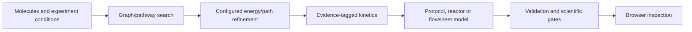

# Chem Sandbox

I built a local chemistry research application connecting molecular representations, candidate reaction search, path refinement, kinetic models and process-level experiments. I implemented the Python service, browser interface, backend integrations, evidence records and scientific checks.

Developed by [Vavan Farizzaman](https://github.com/VavanZaa).

## Algorithm

1. Represent molecules and proposed transformations using molecular graphs and typed experiment inputs.
2. Generate candidate pathways and refine structures/energies through the configured chemistry backend, keeping backend and device provenance.
3. Translate supported reaction information into kinetic or microkinetic models, with explicit units, operating conditions and evidence status.
4. Integrate time-dependent reaction/reactor models and compose sequential protocols or flowsheets.
5. Run controlled comparisons and post-run calibration with separated training and validation evidence.
6. Expose results together with unsupported channels, assumptions and gate failures instead of treating every simulated pathway as a measured yield.

## Workflow



## Run

Commands below assume a Windows terminal at the repository root unless stated otherwise.

```powershell
powershell -NoProfile -File setup.ps1 -CpuOnly
.\start.cmd
```

## Code map

`backend/app/`: search, chemistry, kinetics, protocols, reactors and validation; `backend/tests/`: software checks; `frontend/`: interface; `setup*.cmd` / `setup.ps1`: runtime setup; `docs/`: model contracts and scientific gates.

## Scope and evidence

This is an exploratory research sandbox. General pathway search does not establish accurate yields or a validated physical process. In particular the retained HCN gate has unresolved collision-state and kinetic evidence. Optional native solvers, learned potentials, runtimes and downloaded models must be installed separately; they are not bundled.

This is a focused source snapshot. Installed dependencies, local environments and bulk generated research assets are rebuilt or supplied separately. See [VALIDATION.md](VALIDATION.md) for the checks performed on this export and any remaining setup requirements.
